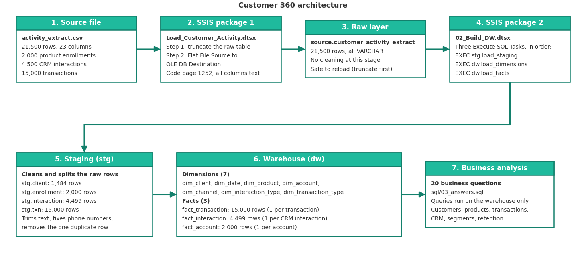

# Customer 360 Data Warehouse – Caroline Thato

This repository holds my solution to the Customer 360 capstone. I built a
data warehouse in SQL Server, loaded by SSIS, from one raw banking extract
with 21,500 events. The extract mixes client details, product enrollments,
CRM interactions and transactions in a single file. The warehouse separates
them so that the BI team can report on customers, products, transactions and
customer service without double counting.

## Architecture



The data moves through seven steps:

1. **Source file.** `activity_extract.csv` has 21,500 rows and 23 columns.
2. **SSIS package 1** (`Load_Customer_Activity.dtsx`) empties the raw table
   and loads the file into it. It reads every column as text (code page 1252)
   so that no value can break the load.
3. **Raw layer.** `source.customer_activity_extract` holds the file exactly
   as it arrived, with nothing cleaned.
4. **SSIS package 2** (`02_Build_DW.dtsx`) runs three SQL steps in order:
   `stg.load_staging`, then `dw.load_dimensions`, then `dw.load_facts`. A fact
   table never loads before the dimensions it needs.
5. **Staging layer (`stg`).** The rows are cleaned and split by event type
   (enrollments, interactions, transactions), and the client details are
   reduced to one row per client.
6. **Warehouse (`dw`).** Seven dimensions and three fact tables.
7. **Business analysis.** The 20 questions are answered with SQL that runs on
   the warehouse only.

## Dimensional model

The warehouse has three fact tables because the file holds three different
kinds of events. Putting them in one table would leave most columns empty and
could count the same thing twice.

| Fact table | One row is | Rows |
|---|---|---:|
| `dw.fact_transaction` | one transaction | 15,000 |
| `dw.fact_interaction` | one CRM interaction | 4,499 |
| `dw.fact_account` | one account (balance, credit limit, loan amount) | 2,000 |

| Dimension | What it describes | Rows |
|---|---|---:|
| `dw.dim_client` | the customer (name, contact details, province, date of birth) | 1,484 |
| `dw.dim_date` | one row for every day from 2022-01-01 to 2026-12-31 | 1,826 |
| `dw.dim_product` | Credit Card, Personal Loan, Savings | 3 |
| `dw.dim_account` | the account number and its status | 2,010 |
| `dw.dim_channel` | where the event happened (Branch, ATM, POS, Call and so on) | 10 |
| `dw.dim_interaction_type` | Complaint, Feedback, Fraud Report, Product Application, Query | 5 |
| `dw.dim_transaction_type` | Deposit, Withdrawal, Fee and so on, and whether money moves in or out | 7 |

The entity relationship diagram is in `docs/retail_bank_erd.png`, with the
draw.io source file next to it.

Main design decisions:

- **Surrogate keys.** Every dimension has its own generated key (`client_key`,
  `date_key` and so on). The source has no IDs for transactions or
  interactions, so I could not rely on it for keys.
- **Client details are Type 1.** The file only holds each client's current
  details and does not say when older details were valid. Keeping a history
  would mean inventing it, so changed details are overwritten.
- **The raw layer is all text.** Checking and converting happens later in SQL,
  where a bad value stops the load with a clear message. A bad value cannot be
  mistaken for a good one.
- **Odd records are kept, not deleted.** Transactions on accounts with no
  enrollment record are kept, and their accounts are marked `is_inferred = 1`.
  Deleting them would remove real money movement.
- **Signed amounts.** Money out is stored as negative, as in the source.
  `amount_abs` holds the size, and questions about "transaction value" use it,
  because a signed total nearly cancels out.

## Data quality

Profiling found, among other things: emails that are blank, padded, in capital
letters or have a space inside; the same email on two different clients; mobile
numbers in five formats; blank gender and blank `resolved_flag` values; one
duplicate row; ten transactions on accounts with no enrollment; and closed
accounts that still hold balances. I fixed what was safe to fix (spaces, case,
phone format), flagged what I could not be sure about, and kept every real
record.

The extract is also uneven over time: activity grows until August 2025 and
then almost stops. This changes how "recent activity" should be read, and the
questions that depend on it are shown at two reference dates.

Full list with counts and the reason for each decision:
[docs/data_quality_note.md](docs/data_quality_note.md)

## ETL implementation

- **Package 1, `Load_Customer_Activity.dtsx`:** an Execute SQL Task truncates
  the raw table, then a Data Flow Task copies the file into it.
- **Package 2, `02_Build_DW.dtsx`:** three Execute SQL Tasks joined by success
  arrows, one for each stored procedure.
- **Splitting by event type:** done in `stg.load_staging`. Each event type goes
  to its own staging table, which does the same job as an SSIS Conditional
  Split.
- **Safe to run again:** the raw and staging tables are emptied and refilled
  each run. The dimension and fact loads use `IF NOT EXISTS` and
  `WHERE NOT EXISTS`, so running the pipeline twice adds nothing new.
- **Fails loudly:** the procedures stop with an error if the raw table is
  empty, an event type is unknown, a date or number cannot be read, or a fact
  table ends up with fewer rows than its staging table. The error numbers are
  listed in [docs/run_pipeline.md](docs/run_pipeline.md).

## Check that the load worked

After a full run, these tables should have these row counts:

| Table | Rows |
|---|---:|
| `source.customer_activity_extract` | 21,500 |
| `stg.enrollment` | 2,000 |
| `stg.interaction` | 4,499 |
| `stg.txn` | 15,000 |
| `stg.client` | 1,484 |
| `dw.dim_client` | 1,484 |
| `dw.dim_account` | 2,010 |
| `dw.dim_product` | 3 |
| `dw.fact_transaction` | 15,000 |
| `dw.fact_interaction` | 4,499 |
| `dw.fact_account` | 2,000 |

The interaction count is 4,499 and not 4,500 because one row appears twice in
the file with every field the same, and the load removes the extra copy.

## Business analysis

All 20 questions are answered in `sql/03_answers.sql`, with my definition of
each business term written above the query. A few results:

- The bank has 1,484 customers. 274 of them (18.5%) have a contact-detail
  problem such as a missing email, a malformed email, no mobile number or an
  email shared with another customer.
- 439 customers hold more than one product, and 366 customers have Savings but
  no Credit Card (the cross-sell list).
- 61 of the 559 open credit cards (10.9%) are within 90% of their limit.
- POS is the busiest transaction channel by both count and value.
- The number of CRM interactions does not predict how much a customer
  transacts.

## How to run the project

You need SQL Server, SQL Server Management Studio (SSMS), and Visual Studio or
SSDT with Integration Services.

1. **Clone the repository** and switch to the branch `intern/caroline-thato`.
2. **Create the database** `Customer360_DW` in SSMS.
3. **Run these scripts in SSMS**, in this order (File > Open > File, then
   Execute):
   - `sql/00_raw_landing.sql`
   - `sql/01_create_dw.sql`
   - `sql/02_etl_procedures.sql`

   Do not run `sql/00_create_tables.sql`. It is the starter file from the
   brief, and `00_raw_landing.sql` replaces it with all-text columns.
4. **Open the SSIS project** in `ssis/` (`Customer360_ETL.slnx`). Point the
   SQL Server connection at your own server and the `Customer360_DW`
   database. Point the `CM_Raw_Activity_CSV` connection at
   `data/raw/activity_extract.csv` on your computer. Set the code page to 1252
   and the header row delimiter to `{LF}`.
5. **Run `Load_Customer_Activity.dtsx`,** then **`02_Build_DW.dtsx`**.
6. **Check the row counts** against the table above.
7. **Run `sql/03_answers.sql`** to see the answers.

A longer guide, with the error messages and what to do about each, is in
[docs/run_pipeline.md](docs/run_pipeline.md). `sql/99_reset_dw.sql` is optional.
It deletes the staging and warehouse tables so you can start again.

## What is in this repository

| Path | What it holds |
|---|---|
| `sql/00_raw_landing.sql` | the raw landing table, all columns text |
| `sql/01_create_dw.sql` | the staging and warehouse tables |
| `sql/02_etl_procedures.sql` | the three load procedures |
| `sql/03_answers.sql` | the 20 business questions |
| `sql/99_reset_dw.sql` | optional reset script |
| `ssis/` | the SSIS project and both packages |
| `docs/data_quality_note.md` | data quality findings and decisions |
| `docs/run_pipeline.md` | how to run the pipeline, step by step |
| `docs/retail_bank_erd.png` | entity relationship diagram |
| `docs/retail_bank_erd.drawio` | draw.io source of the ERD |
| `docs/architecture.png` | architecture diagram |
| `docs/architecture.drawio` | draw.io source of the architecture diagram |

---

# Original project brief
# Customer 360 Intern Project

A self-contained data engineering capstone for the April-May 2026 intern
intake: build a star-schema data warehouse from a single raw banking
extract, using SSIS and SQL Server.

**Due date: 27 September 2026.** Open your pull request by this date, see
[How to submit your work](#how-to-submit-your-work).

## Background

You work in the data team of a South African retail bank. The bank's
systems were never designed to talk to each other, and the only thing
anyone has ever managed to get out of them is a single flat export: one
big activity file covering client details, product enrollments, CRM
contact history, and transactions, all mixed together. Nobody has ever
built a proper warehouse for this data. Reporting today is a person
manually pulling spreadsheets.

You have been asked to build the first version of a Customer 360 data
warehouse: a dimensional model that the BI team can connect Power BI or
Tableau to, fed by a repeatable SSIS ETL pipeline.

## Objective

Design and build a star schema data warehouse in SQL Server, loaded by
SSIS, from the single raw extract provided in `data/raw/`. Use it to
answer the business questions in `docs/questions.md`.

This is a skills project. The point is not to reach one correct answer,
it is to show that you can:

* Profile a messy, denormalized source file and work out what is
  actually in it
* Recognize the different entities and event types hiding inside a
  single extract, and design sensible keys for each
* Design a sensible dimensional model: grain, dimensions, facts, and how
  they relate
* Build an SSIS package that lands, splits, and transforms the data
* Write SQL against your model to answer real business questions
* Explain and justify the decisions you made

There is no single correct schema. Two interns can both pass with
different, well justified designs.

## Repo structure

```
README.md                     this file, the full brief
data/raw/
    activity_extract.csv       the one raw source file, comma delimited
docs/
    dictionary.md               column level definitions of the raw extract
    questions.md                 the questions to answer with SQL against your model
sql/
    00_create_tables.sql        DDL for the landing/source schema
```

Keep this same short, flat naming style for anything you add: lowercase,
underscores, no spaces, no version numbers in the file name (git already
tracks versions for you).

## What you are given

`data/raw/activity_extract.csv` is a single comma delimited file, exactly
as it came out of the source system, not cleaned and not split into
tables. Every row is one event for one client. An `event_type` column
tells you whether the row is a product enrollment, a CRM interaction, or
a transaction, and a different subset of the remaining columns is
populated depending on which type it is. Client details such as name,
contact details, and signup date repeat on every row belonging to that
client.

There are no ready made table identifiers in this file. There is a
client_number and an account_number, because a real extract still needs
something to key on, but there is nothing marking out separate
enrollment, interaction, or transaction records. Working out how to key
and deduplicate each entity is part of the exercise.

See `docs/dictionary.md` for a full column reference. Treat this as a
real source system handoff. Nobody has told you what is wrong with it.
Profiling it is part of the task.

`sql/00_create_tables.sql` gives you a `CREATE TABLE` statement for a
single `source` schema table matching the raw file, so you have a
consistent landing point to import into via SSIS, using a Flat File
Source. You are not required to use it as is. Adjust data types if your
profiling says otherwise, and justify the change.

## What you must build

### ETL (SSIS)

* One or more SSIS packages, built in Visual Studio or SSDT with the
  SSIS extension, that load the raw extract into SQL Server and populate
  your dimensional model.
* Use a staging layer, a raw load with minimal transformation, separate
  from the final dimensional model. Do not transform everything in a
  single monolithic step.
* Use a Conditional Split, or an equivalent approach, to separate the
  three event types out of the single source file before building your
  dimensions and facts from them.
* Handle at least: data type conversion, whitespace and casing cleanup,
  and invalid or missing values. Decide for yourself what counts as
  invalid here, profile the data first.
* Sequence your control flow correctly. A fact cannot load before the
  dimension it depends on exists.
* Your packages must be re runnable without duplicating data. Truncate
  and reload is acceptable for this exercise. Incremental loading is a
  bonus, not a requirement.

### Dimensional model

Design a star schema, or a snowflake schema if you can justify it, in a
`dw` schema in SQL Server. At minimum you will need:

* A date dimension. Build it, do not carry raw date strings into your
  facts.
* A client dimension, built by deduplicating the repeated client details
  in the source file.
* A product dimension, built from the enrollment style rows.
* At least two fact tables at different, clearly stated grains, for
  example one fact per transaction and one fact per CRM interaction. You
  may combine them if you can justify the resulting grain.

You decide: how you generate surrogate keys for each dimension, since the
source file does not hand you any, which attributes belong on which
dimension, whether the client dimension needs to track history (SCD Type
1 versus Type 2, pick one and be able to explain why), and how you handle
the data quality issues you find, whether that is rejecting, correcting,
or flagging them with an unknown member row. All are valid approaches,
pick one and justify it.

Deliver an entity relationship diagram of your final model, built in
[draw.io](https://app.diagrams.net/) (diagrams.net), alongside the DDL.
Export it as a PNG or PDF and commit both the export and the `.drawio`
source file.

### SQL analysis

Write the SQL queries that answer every question in `docs/questions.md`,
run against your dimensional model, not the raw or staging tables.
Include the SQL and the result for each.

## Tech stack

* SQL Server, Developer or Express edition, plus SQL Server Management
  Studio
* SQL Server Integration Services, via SSDT or Visual Studio
* draw.io (diagrams.net) for the entity relationship diagram

## How to submit your work

1. Fork this repo to your own GitHub account (or create a branch if you
   already have write access).
2. Clone your fork locally: `git clone <your-fork-url>`.
3. Create a branch for your work, named after you, for example
   `git checkout -b intern/thabo-m`.
4. Commit as you go, in small steps, with clear messages, for example
   `git commit -m "Add dw schema DDL for client and date dimensions"`.
   Do not commit one giant "final version" at the end.
5. Push your branch: `git push origin intern/thabo-m`.
6. Open a pull request against this repo's `main` branch when you are
   ready for review. Put your data quality note and a short summary of
   your design decisions in the pull request description.

Commit your SSIS project files, your DDL scripts, your SQL answer
scripts, your draw.io diagram, and your data quality write-up. Do not
commit SQL Server backup files (`.bak`) or anything containing real
credentials or connection strings with passwords in them.

## Deliverables checklist

* `dw` schema DDL, dimensions and facts, with comments explaining key
  design decisions
* Entity relationship diagram of the final dimensional model (draw.io
  source file plus a PNG or PDF export)
* SSIS project, package files and project file
* A short data quality note describing what you found in the raw file
  and how you handled each issue
* SQL scripts answering every question in `docs/questions.md`, with
  results
* A short write-up explaining how to run your pipeline end to end

## Suggested timeline

Two weeks, structured roughly as follows.

Days one and two: profile the raw extract, document the data quality
issues you find, and sketch the dimensional model on paper or in draw.io
before writing any DDL.

Days three and four: build the staging load in SSIS, and write the `dw`
schema DDL.

Days five to seven: build the dimension and fact loads in SSIS, and test
the pipeline end to end.

Days eight and nine: write and validate the SQL for every question.

Day ten: write up your data quality notes, finish the entity relationship
diagram, and open your pull request.

## Evaluation criteria

You will be assessed on the following.

**Correctness.** Does the model actually answer the business questions,
and do the numbers make sense? For example, no double counted
transactions from a bad join.

**Modelling judgment.** Sensible grain, sensible key choices, dimensions
and facts used correctly, and evidence that the design followed from
profiling the data rather than from whichever join happened to work
first.

**ETL craftsmanship.** Is the SSIS package readable, does it fail loudly
on bad data rather than silently succeeding, and is it re runnable.

**Data quality handling.** Did you find the real issues in the file, and
did you make and justify a defensible decision about each one, rather
than deleting anything that looked unusual.

**Communication.** Can you explain your design decisions to a non
technical stakeholder in your write up and pull request description.
